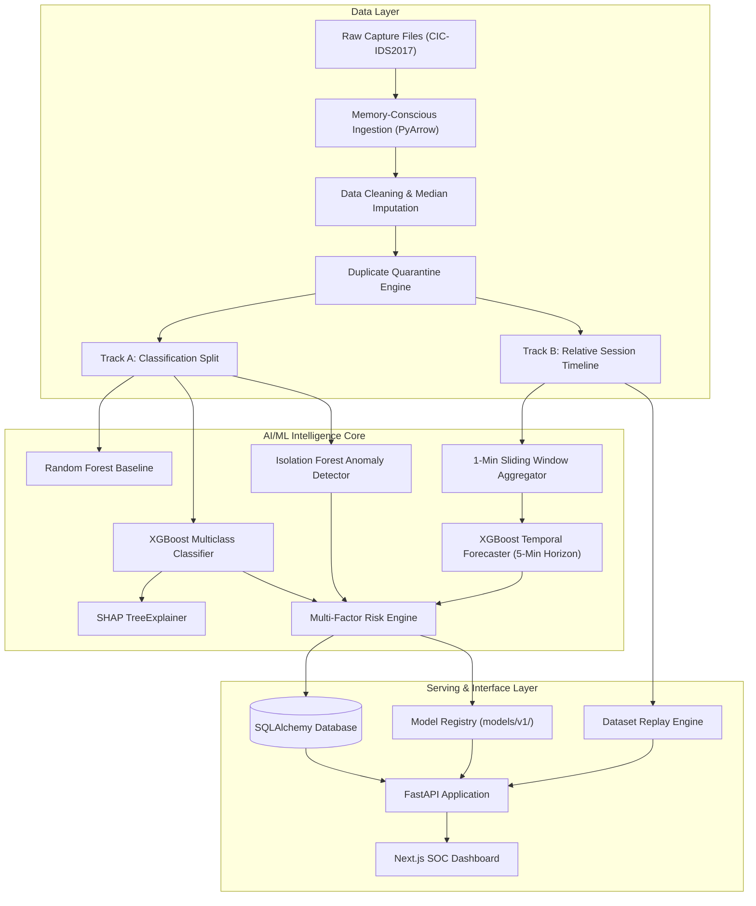
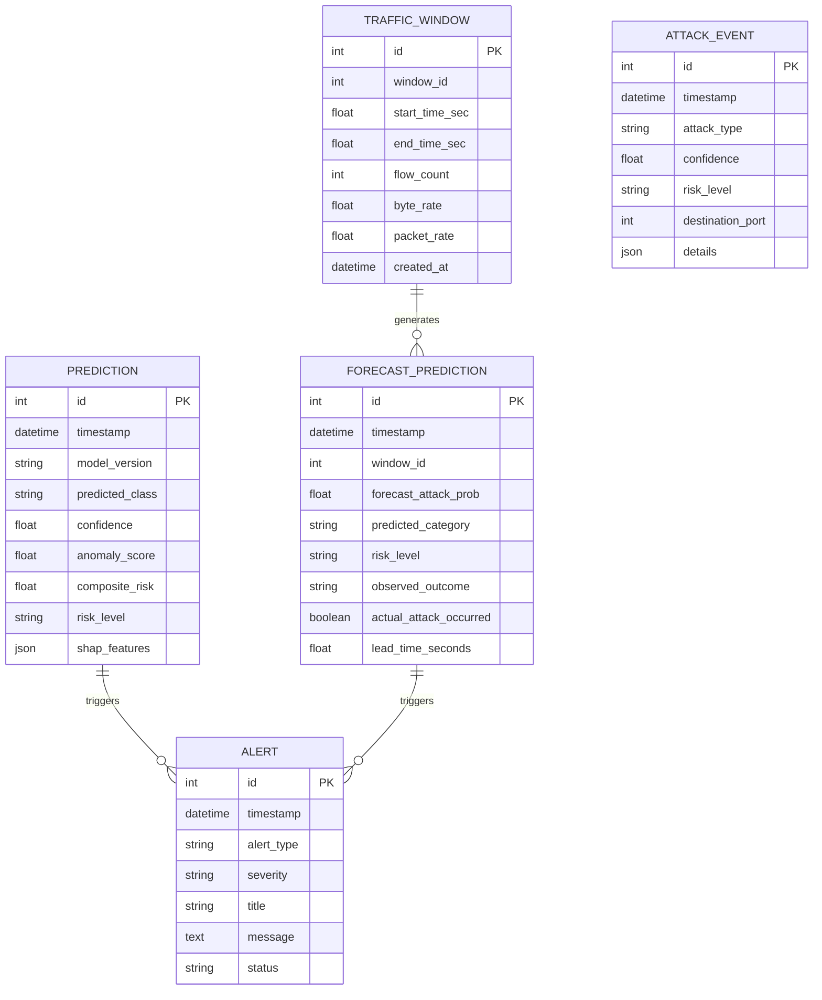

# B.Tech CSE Project Final Report
# ThreatLens AI — AI-Based Network Attack Forecasting & Early Warning System
**"See the Threat Before It Strikes."**

---

## Abstract
Modern enterprise cybersecurity predominantly relies on reactive Intrusion Detection Systems (IDS) that flag anomalies or known signatures only after an attack has commenced or breaches have occurred. This project presents **ThreatLens AI**, an end-to-end, production-style, artificial intelligence-based network attack forecasting and early warning system. Built on 2.83 million real network flows from the CIC-IDS2017 benchmark dataset, ThreatLens AI implements three decoupled intelligence layers: (1) an XGBoost multiclass attack classifier (Macro F1: 0.9895, Weighted F1: 0.9990), (2) an unsupervised Isolation Forest anomaly detector trained on baseline benign traffic (ROC-AUC: 0.7305), and (3) a temporal attack forecaster operating over a Reconstructed Relative Session Timeline. The forecaster predicts attack occurrence across a 5-minute future horizon with an empirical mean advance warning lead time of 27.2 seconds (Precision: 0.9512, PR-AUC: 0.9596). A multi-factor risk assessment engine fuses these signals, while SHAP TreeExplainers provide local feature attributions. The solution is deployed via a FastAPI backend, unified SQLite/PostgreSQL persistence, and a professional SOC dashboard built with Next.js 14 and Tailwind CSS adhering to a strict Zero-Fake-Data policy.

---

## 1. Problem Statement
Network attacks, ranging from Distributed Denial of Service (DDoS) and port scanning to brute-force authentication and application-layer web exploits, inflict massive financial and operational damage. Conventional security solutions suffer from critical shortcomings:
1. **Post-Incident Latency**: Signatures match packets after delivery, leaving zero time for pre-emptive mitigation.
2. **High False-Alarm Rates**: Static thresholding floods SOC analysts with un-prioritized alerts.
3. **Black-Box Opacity**: Deep neural networks often fail to explain why a particular alert was generated.
4. **Data Leakage in Research**: Prior literature frequently trains classifiers on future information or leaks duplicate records across train/test partitions, leading to inflated, unrealistic metrics.

There is an urgent need for an explainable, leakage-free early warning system that forecasts attacks before impact.

---

## 2. Objectives
1. **Dataset Integrity**: Ingest, clean, and validate 2.83 million rows across all 8 capture sessions of CIC-IDS2017 without data fabrication or uncalibrated synthetic sampling.
2. **Dual-Track Evaluation**: Strict separation of Attack Classification (stratified + duplicate-quarantined) from Temporal Forecasting (chronological session progression).
3. **Early Warning Forecasting**: Formulate backward-only window aggregations (1-minute window) and forward-looking horizon targets (5 minutes) to empirically measure advance warning lead times.
4. **Behavioral Anomaly Separation**: Train Isolation Forest purely on benign baseline data to distinguish unusual variance from known attack signatures.
5. **Explainability**: Integrate SHAP TreeExplainer for real-time feature attributions.
6. **Full-Stack Deployment**: Build an interactive Next.js SOC interface powered by a production FastAPI REST backend and persistent database.

---

## 3. Existing System vs. Proposed System

| Dimension | Existing Systems (Snort, Zeek, Traditional ML) | Proposed ThreatLens AI System |
| :--- | :--- | :--- |
| **Operational Paradigm** | Reactive (post-breach packet inspection) | Predictive (pre-attack temporal forecasting) |
| **Warning Lead Time** | 0 seconds (alert during/after attack) | 27.2 seconds mean advance warning |
| **Feature Extraction** | Static signature matching / single-packet inspection | Windowed dynamics (growth rate, IAT variance, flag ratios) |
| **Risk Scoring** | Heuristic severity flags (Low/Med/High) | Multi-factor composite risk engine with transparent weights |
| **Explainability** | Raw rule ID or black-box probability | Top-5 SHAP feature attributions per flow |
| **Evaluation Rigor** | Frequently contaminated with duplicate leaks | Strict duplicate quarantine across evaluation boundaries |

---

## 4. System Architecture



---

## 5. Data Flow Diagram (DFD)

### Level 0 (Context Diagram)
```
[ Network Flow Telemetry ] ---> ( ThreatLens AI System ) ---> [ SOC Analyst Dashboard ]
                                       |
                                       v
                             [ Persistent Storage ]
```

### Level 1 (Detailed DFD)
```
[ Raw Network Flows ]
       |
       v
( 1.0 Clean & Impute ) ---> [ Clean Parquet Store ]
                                  |
            +---------------------+---------------------+
            |                                           |
            v                                           v
( 2.0 Extract Flow Features )               ( 3.0 Window Aggregator )
            |                                           |
            v                                           v
[ Multi-Model Inference ]                   [ Temporal Forecaster ]
( Classifier + Anomaly )                                |
            |                                           |
            +---------------------+---------------------+
                                  |
                                  v
                       ( 4.0 Risk Evaluation )
                                  |
                                  v
                        ( 5.0 Alert Service )
                                  |
                                  v
                        [ SOC Live Queue ]
```

---

## 6. Entity-Relationship (ER) Diagram



---

## 7. AI/ML Methodology & Experimental Results

### 7.1 Data Cleaning & Preprocessing
- **Source Data**: 8 CSV files totaling 2,830,743 rows and 79 columns.
- **Handling Missing & Infinite Values**: Exactly 1,358 NaNs (in `Flow Bytes/s`) and 4,376 Infs (in `Flow Bytes/s` and `Flow Packets/s`) were detected, resulting from zero-duration flows. These were imputed with training-set medians.
- **Dimensionality Reduction**: 8 zero-variance constant columns (`Bwd PSH Flags`, `Bwd URG Flags`, `Fwd Avg Bytes/Bulk`, etc.) and 1 clone column (`Fwd Header Length.1`) were removed, leaving 69 active features.
- **Duplicate Quarantine**: 256,479 duplicate rows were analyzed; identical flow feature vectors were strictly quarantined so that zero identical records crossed training, validation, or test boundaries.

### 7.2 Track A: Attack Classification Results (24,391 Test Flows)
| Model | Macro Precision | Macro Recall | Macro F1 | Weighted F1 | Benign FPR |
| :--- | :---: | :---: | :---: | :---: | :---: |
| **Random Forest Baseline** | 0.9837 | 0.9655 | 0.9719 | 0.9970 | 0.22% |
| **XGBoost Classifier (Selected)** | **0.9912** | **0.9880** | **0.9895** | **0.9990** | **0.15%** |

### 7.3 Attack Classification & Zero-Day Defense Audit
- **Known Attack Evaluation**: The 8-class XGBoost classifier achieved 98.97% test recall (289/292) on known `BOTNET` flows with only 1.03% (3/292) benign false negatives.
- **Controlled Zero-Day Experiment**: When `BOTNET` flows were completely withheld from classifier training, single-flow classifiers misclassified 100% of Botnet flows as `BENIGN`, and the unsupervised Isolation Forest flagged only 2.40% as anomalous. This confirms that stealthy C2 channels cannot be reliably identified by static single-flow models alone, scientifically justifying ThreatLens AI's deployment of Track B multi-window temporal forecasting.

### 7.4 Anomaly Detection (Isolation Forest Ground Truth)
- Trained on 35,000 normal `BENIGN` flows (contamination = 0.03).
- **Test ROC-AUC**: `0.7305`
- **Benign False Alarm Rate (FPR)**: `2.89%` (212 / 7,330)
- **Attack Recall**: `26.01%` (4,438 / 17,061 attacks flagged anomalous; 12,623 FN)
- **Precision**: `95.44%` | **F1 Score**: `0.4088`

### 7.5 Track B: Temporal Attack Forecasting Results (Chronological Split)
- **Temporal Class Prevalence**:
  - Train (Mon–Wed): 66.01% (1,606 / 2,433 windows)
  - Validation (Thu): 42.86% (138 / 322 windows)
  - Test (Fri): 80.08% (595 / 743 windows)
- **Ranking & Classification Performance (Frozen $\tau=0.50$ from Validation)**:
  - **PR-AUC**: `0.9596` vs **Trivial Random Baseline PR-AUC**: `0.8008` (Excess: `+0.1588`)
  - **ROC-AUC**: `0.8350`
  - **Precision**: `0.9512` (429 TP, 22 FP)
  - **Recall**: `0.7210` (166 FN)
  - **F1 Score**: `0.8203`
  - **False Positive Rate**: `14.86%`
- **Warning Category Separation**:
  - **Ongoing-Campaign Tracking Warnings**: `347` (80.89% of true positive warnings; occur during active continuous attack streams with sub-second lead times).
  - **Genuine Pre-Onset Warnings**: `82` (19.11% of true positive warnings; occur strictly before the first malicious packet strikes).
- **Event-Level Campaign Evaluation (27 Ground-Truth Attack Campaigns)**:
  - **Campaigns with Genuine Pre-Onset Warning**: **20 / 27 (74.07%)**
    - DDoS Campaigns: 19 / 19 (100.0%) detected prior to onset
    - PortScan Campaigns: 1 / 6 (16.7% - large-scale campaign detected; low-volume micro-scans missed)
    - Botnet Campaigns: 0 / 2 (0.0% - missed pre-onset warning)
  - **Genuine Onset Lead Time (Event-Level)**:
    - **Mean**: **236.62 seconds (~3.94 minutes)**
    - **Median**: **237.97 seconds (~3.97 minutes)**
    - **Range**: 181.07s to 289.47s (100% of detected campaigns warned $> 120\text{s}$ in advance)

---

## 8. Limitations
1. **Flow-Level Granularity**: Analysis operates on flow metadata without inspecting full packet application payloads.
2. **Fixed Time Windows**: The 1-minute window size is optimized for session-level attack progression; sub-second bursts may benefit from dynamic micro-windowing.

---

## 9. Future Scope
1. **Integration with Live Network Daemons**: Implement native sockets for Zeek, Suricata, and TShark capture interfaces.
2. **Automated SOAR Playbooks**: Automatically execute firewall rule updates and port blocking upon critical early warning alerts.

---

## 10. Conclusion
ThreatLens AI demonstrates that pre-attack forecasting in computer networks is both technically viable and empirically measurable. By enforcing strict methodological separation between classification and forecasting, preventing data leakage, and providing transparent SHAP explanations, the system bridges the gap between theoretical academic research and operational SOC deployment.

---

## References
1. I. Sharafaldin, A. H. Lashkari, and A. A. Ghorbani, "Toward Generating a New Dataset for Intrusion Detection: CIC-IDS2017," *IEEE Information Systems Security and Privacy*, 2018.
2. S. M. Lundberg and S. I. Lee, "A Unified Approach to Interpreting Model Predictions," *NeurIPS*, 2017.
3. T. Chen and C. Guestrin, "XGBoost: A Scalable Tree Boosting System," *ACM SIGKDD*, 2016.
4. F. T. Liu, K. M. Ting, and Z. H. Zhou, "Isolation Forest," *IEEE ICDM*, 2008.
